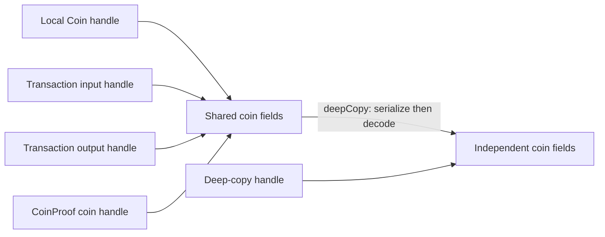

# Coin ownership lab — equal values are not the same object

This lab follows a fidelity gap found while porting `txnmmr`: Java gives a witness proof the same coin object held by a transaction. The native implementation originally copied the coin. Initially the copies serialize identically, so ordinary fixture comparisons can miss the error.

Read the [Coin lesson](../files/src/org/minima/objects/Coin.md), [CoinProof lesson](../files/src/org/minima/objects/CoinProof.md), [Java experiment](../../support/ObjectOracle.java), [native experiment](../../support/objects.cpp), and [differential driver](../../tools/object_differential.py) together.

## Learning objective

Distinguish three operations:

| Operation | Object identity | Expected effect of later mutation |
|---|---|---|
| Assign another Java reference or retain a coin in a transaction/proof | Same coin | All owners observe its changed fields. |
| `deepCopy()` | New coin, reconstructed from bytes | Changes remain isolated. |
| Assign a different coin to one local variable | The variable changes its target | Other owners still refer to the original coin. |

Imagine two library catalogue entries referring to one physical book. Changing that book's condition affects both entries. Photocopying the book creates a separate object. Equal contents on day one do not tell you which operation occurred.

## Reuse before changing representation

The pinned Java `Coin` constructor and setters, `Transaction.addInput/addOutput`, and `CoinProof` constructor establish the reference behavior. The existing native `Coin` reader, writer, JSON, hashing and `deepCopy()` provide the compatible algorithms. `BlockMMR.hpp` already calls `deepCopy()` explicitly before marking coins spent or assigning new MMR metadata, matching the Java block-processing code.

The sibling port at `/Users/eurobuddha/Projects/minima/tools/minima-core-cpp/src/objects/` also stores coin values. Its codec has additional differences, including its spent-field encoding and token handling. It cannot supply this ownership correction. Existing native shared ownership, used by `TxBlock`, supplies the lifetime-management approach; the smallest new representation needed is one shared allocation containing the existing coin fields.

## Build an experiment that can fail

The `coinalias` command starts with the existing `coin(n)` fixture. It retains the coin in two transaction input positions, an output position, a `CoinProof`, and a witness. It also retains a local alias, an input getter result, and the removed first input. Separately it creates a deep copy, a renamed deep copy, and a proof decoded from serialized bytes.

The corpus combines five fixture indexes (0, 1, 4, 7, 31), four growth amounts (0, 1, 17, 257), and eleven mutation targets: **5 × 4 × 11 = 220 programs**. Growth happens before the mutation and tests lifetime across native vector reallocations. The native test retains a `Coin` handle, never a pointer into a vector across its growth.

Each program changes the selected coin's ID, token ID, spent flag, storage flag, creation height, MMR entry, token descriptor, and state contents. The MMR entry is `2^100`, so it exercises an existing large-number path too. It compares every retained coin, the proof and witness coin, and the proof's newly calculated leaf using exact serialized bytes and JSON.

Next it clears the containers, changes the retained coin's state and token, and reassigns one local alias to another coin. A second snapshot tests lifetime and the difference between mutating an object and rebinding a variable. The driver requires all 38 result fields from Java; a pair of generic `ERROR` replies cannot pass this experiment.

## Read the first failing observation

For `coinalias 0 0 0`, the initial coin ID is `0x01`. We change the original coin to `0xAABB`. The retained baseline shows:

| Observation | Java | C++ before correction |
|---|---|---|
| Original coin ID | `0xAABB` | `0xAABB` |
| Local alias coin ID | `0xAABB` | `0x01` |
| Proof's coin ID | `0xAABB` | `0x01` |
| Explicit deep copy's ID | `0x01` | `0x01` |

The original setter worked in both languages. The disagreement appears only when another owner reads the coin. That evidence locates the problem in ownership, rather than in ID parsing or serialization. The deep copy remaining unchanged is correct and must survive the fix.

## Representation and deep-copy boundaries

The correction makes an ordinary native `Coin` copy a handle sharing its field storage. `std::shared_ptr` retains that storage until its last owner disappears, independently of vector storage. Each constructor and decoder creates new storage; `deepCopy()` still uses the existing encode/decode algorithm, so it creates a genuinely independent coin. Assignment changes which storage the handle owns.

The native ownership graph after construction is:



A `Coin&` referring to a vector element is still subject to ordinary C++ iterator/reference invalidation. To retain a Java-like coin reference across container growth or removal, keep a `Coin` handle by value. This distinction is part of the native API contract.

## Evidence checkpoint

The completed baseline compared 9,464 cases: the previous 9,244 cases passed and all 220 new ownership cases failed. The first mismatch was `coinalias 0 0 0`, which mutates the original coin without container growth. The retained report is `cpp/build/coin-alias-baseline-results.json`.

Both full builds succeeded without compiler warning/error lines. Both corrected object suites pass **9,464 cases**, including all **220 ownership programs**. The normal regression run passes all **21 selected checks** in 303.51 seconds. The first sanitizer run finishes 20 of 21 successfully in 703.82 seconds; block ownership reaches its 240-second timeout while running concurrently with other checks. The isolated rerun passes all **1,558 programs and 6,219 operations** in **141.61 seconds**, using the same timeout and corpus. It ran with process-management access after the sandbox denied process inspection during timeout cleanup. Timing and permissions both differed, so this does not isolate one cause for the first timeout.

All 18 comparison reports from each build were inspected after completion and contain zero differences. The selected checks cover object encoding and ownership, transaction/header tests, KISS VM, chain/cascade/MMR, RAM/custom/coin databases, search, block ownership, mining/processing, witness commands, checker logs and consensus. This is a scoped regression set, not every registered test or complete Java parity.

To repeat the focused object experiment after building:

```sh
ctest --test-dir cpp/build -R '^object_differential$' --output-on-failure
ctest --test-dir cpp/build-sanitized -R '^object_differential$' --output-on-failure
```

Final object reports are `cpp/build/object-differential-results.json` and `cpp/build-sanitized/object-differential-results.json`. The original `CoinTests.cpp` counterpart is still absent; this additional experiment does not count as that source-file conversion.

## Limits and exercises

This experiment does not establish shared state-list identity between *different* coins, mutation of separately retained token objects, MMRProof identity, null object fields, failed in-place coin reads, or full node behavior. The subsequent [reader lab](coin-streams.md) tests outer proof identity, an owned shared state-list bridge, partial reads and copy/converter failures. Nested object identity and full-node behavior remain open. Mapping status remains partial.

1. Why can `cp.getMMRData()` change after a coin mutation? **Answer:** the leaf is calculated from the coin's current bytes and amount; it is not a cached snapshot made by the wrapper constructor.
2. Why must `deepCopy()` stay independent? **Answer:** block processing intentionally modifies copies when producing spent and newly indexed records. Sharing those copies would alter their source records.
3. Why test removal as well as growth? **Answer:** an owner can disappear while another still needs the object. Correct shared ownership must preserve the latter's lifetime.
4. Does this test authenticate a coin's MMR membership? **Answer:** no. It checks ownership and derived leaf consistency, not acceptance against a trusted MMR root.
